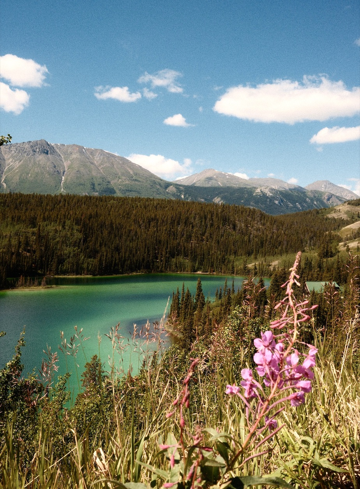

# Color Quantization

A Python implementation of k-means clustering that reduces an image to a smaller color palette.

## Before and after

The example uses `IMAGE_FILE = "test1.jpeg"` and `K = 10`: pixels are clustered by RGB distance and replaced with their cluster's mean color. The saved result contains exactly 10 colors at the original resolution (924 × 1254). Initial centroids are random, so results can vary between runs.

| Before | After — quantized to 10 colors |
| --- | --- |
|  |  |

## Run

Requires Python 3 and a desktop image viewer.

```sh
git clone https://github.com/tjdavis51/color-quantization.git
cd color-quantization
python3 -m venv venv
source venv/bin/activate
python -m pip install -r requirements.txt
python color_quantization.py
```

The program prints the iteration count and opens the quantized image in your image viewer. Save it from the viewer if desired; the script does not automatically write `output.png`. The included `output.png` is the saved example shown above.
